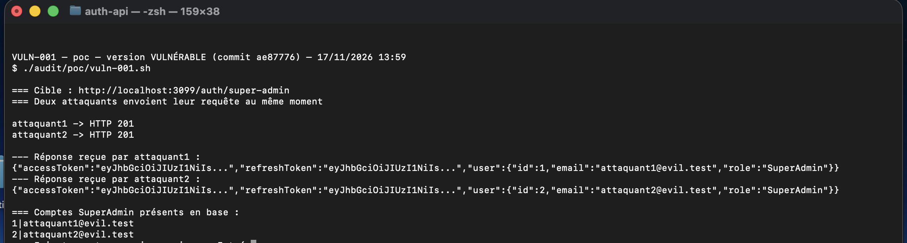
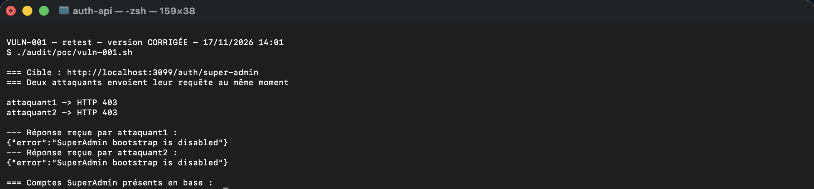

# VULN-001 : n'importe qui peut devenir SuperAdmin

Identifiant : VULN-001

Nom : La route qui crée le premier SuperAdmin est ouverte à tout le monde

Localisation : `POST /auth/super-admin`, fonction `createSuperAdmin` dans `src/controllers/auth.controller.ts`

Criticité : Élevée. Une seule requête, sans compte, suffit pour prendre le contrôle de toute l'API. Je ne la classe pas critique parce que ça ne marche que sur une base vide, donc juste après un déploiement.

Statut : Corrigée et retestée

## Description

Cette route sert à créer le tout premier SuperAdmin. Elle ne se fermait que si
`NODE_ENV=production`, et le projet ne définit cette variable nulle part. Résultat : elle
restait ouverte.

Il y avait un deuxième problème. Le code vérifie d'abord qu'aucun SuperAdmin n'existe, puis crée
le compte environ 60 ms plus tard. Si deux requêtes arrivent en même temps, les deux passent la
vérification et on se retrouve avec deux SuperAdmins. C'est une condition de course.

## Scénario d'exploitation

L'API vient d'être mise en ligne. Un attaquant appelle la route avant l'équipe et devient
SuperAdmin. Il peut ensuite se créer un compte Admin de secours pour garder l'accès.

## Preuve (PoC)

Sur le code vulnérable (commit `ae87776`), base vide. Deux attaquants envoient cette requête au
même moment :

```http
POST /auth/super-admin HTTP/1.1
Host: localhost:3099
Content-Type: application/json

{"email":"attaquant1@evil.test","password":"Password123!"}
```

Script : [poc.sh](poc.sh)

```bash
./audit/outils/demo.sh 001 poc
```

```text
attaquant1 -> HTTP 201
attaquant2 -> HTTP 201

=== Comptes SuperAdmin présents en base :
1|attaquant1@evil.test
2|attaquant2@evil.test
```

Les deux attaquants sont SuperAdmin.



## Impact

L'attaquant contrôle toute la plateforme. Il lit tous les tickets et les emails des
utilisateurs, et il peut désactiver les vrais administrateurs. Ce sont des données personnelles
qui fuient, donc il y a aussi un problème RGPD.

## Correction

J'ai fermé la route par défaut. Elle ne s'ouvre que si on envoie le bon secret dans l'en-tête
`X-Bootstrap-Token`. Ce secret (`SUPERADMIN_BOOTSTRAP_TOKEN`) n'est connu que du propriétaire,
et la comparaison se fait à temps constant pour ne rien laisser deviner. J'ai aussi ajouté un
verrou pour bloquer deux créations en même temps.

Avant :
```ts
if (process.env.NODE_ENV === 'production' && process.env.ALLOW_SUPERADMIN_BOOTSTRAP !== 'true') {
  return res.status(403).json({ error: 'SuperAdmin bootstrap is disabled' });
}
```

Après :
```ts
if (!isBootstrapAuthorized(req)) {            // secret absent ou faux
  return res.status(403).json({ error: 'SuperAdmin bootstrap is disabled' });
}
if (bootstrapInProgress) {                    // deux requêtes en même temps
  return res.status(409).json({ error: 'SuperAdmin bootstrap already in progress' });
}
```

## Retest

Même script, sur le code corrigé :

```text
attaquant1 -> HTTP 403
attaquant2 -> HTTP 403

=== Comptes SuperAdmin présents en base :
```

Les deux sont refusés et la liste est vide : aucun compte n'a été créé.



Les tests automatiques vérifient aussi le cas normal : le propriétaire avec le bon secret crée
bien son compte, et une deuxième tentative est refusée. Ce sont les 7 tests `(VULN-001)` de
`tests/security.test.ts`.

Résultat : la faille n'est plus exploitable.
