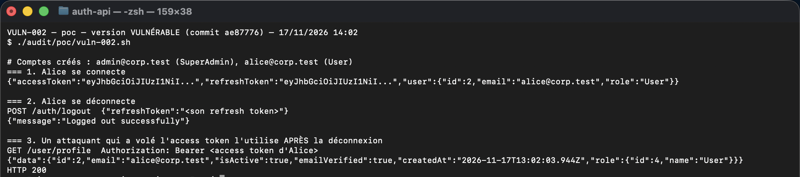
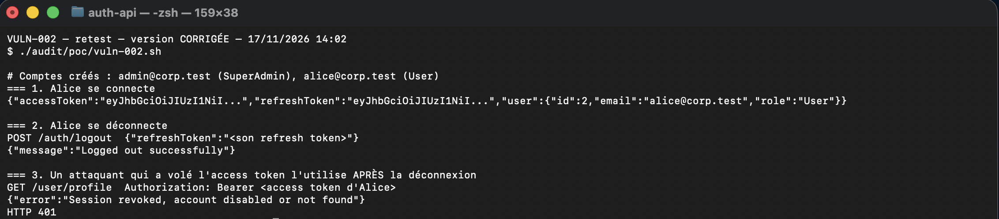

# VULN-002 : le token marche encore après la déconnexion

Identifiant : VULN-002

Nom : La déconnexion ne coupe pas l'access token

Localisation : `POST /auth/logout` (fonction `logout` dans `src/controllers/auth.controller.ts`) et `authMiddleware` dans `src/middlewares/auth.middleware.ts`

Criticité : Moyenne. Un token volé reste utilisable jusqu'à 15 minutes après la déconnexion. Il faut quand même avoir volé le token avant, et la durée est limitée.

Statut : Corrigée et retestée

## Description

Au logout, l'API révoquait seulement le refresh token. L'access token, lui, n'était contrôlé que
sur sa signature et sa date d'expiration. Le serveur ne savait donc pas que la session était
fermée. L'utilisateur pense avoir coupé l'accès, alors que celui qui a son token peut continuer.

## Scénario d'exploitation

Alice se connecte sur un ordinateur partagé, ou son token fuit (extension de navigateur, logs).
Elle se déconnecte. L'attaquant utilise son access token et continue de lire son profil et ses
tickets.

## Preuve (PoC)

Sur le code vulnérable (commit `ae87776`). Alice se déconnecte :

```http
POST /auth/logout
Content-Type: application/json

{"refreshToken":"<refresh token d'Alice>"}
```

Puis l'attaquant utilise l'access token d'Alice :

```http
GET /user/profile
Authorization: Bearer <access token d'Alice>
```

```bash
./audit/outils/demo.sh 002 poc
```

```text
=== 2. Alice se déconnecte
{"message":"Logged out successfully"}

=== 3. Un attaquant qui a volé l'access token l'utilise APRÈS la déconnexion
{"data":{"id":2,"email":"alice@corp.test",...}}
HTTP 200
```

L'attaquant lit le profil d'Alice alors qu'elle est déconnectée.



## Impact

Après la déconnexion, l'attaquant peut encore lire et modifier les tickets et les messages
d'Alice. La déconnexion est le premier réflexe de sécurité d'un utilisateur, et ici elle ne sert
à rien.

## Correction

Chaque access token contient maintenant l'identifiant de sa session (`sid`, l'id de la ligne
`RefreshToken`). À chaque requête, le middleware vérifie que cette session est encore active.
Un logout, un reset de mot de passe ou une désactivation du compte coupent donc l'accès tout de
suite.

Avant :
```ts
// auth.middleware.ts : seule la signature du token est vérifiée
const sessionUser = await getSessionUser(payload.userId);
```

Après :
```ts
// auth.middleware.ts
if (!payload || typeof payload.userId !== 'number' || typeof payload.sid !== 'number') return 401;
const sessionUser = await getSessionUser(payload.userId, payload.sid);

// session.service.ts : la session doit exister, appartenir à l'utilisateur et être active
if (!session || session.userId !== userId || session.revokedAt || session.expiresAt < new Date()) return null;
```

Fichiers modifiés : `src/services/session.service.ts`, `src/middlewares/auth.middleware.ts`,
`src/types/index.ts`.

## Retest

Même script, sur le code corrigé :

```text
=== 3. Un attaquant qui a volé l'access token l'utilise APRÈS la déconnexion
{"error":"Session revoked, account disabled or not found"}
HTTP 401
```



Tests automatiques : bloc `(VULN-002)` de `tests/security.test.ts`. Ils vérifient qu'une session
révoquée, la session d'un autre utilisateur ou un token sans session donnent `401`.

Résultat : la faille n'est plus exploitable.
