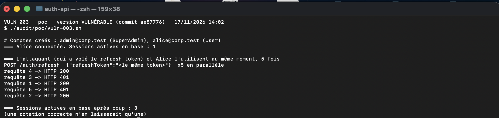
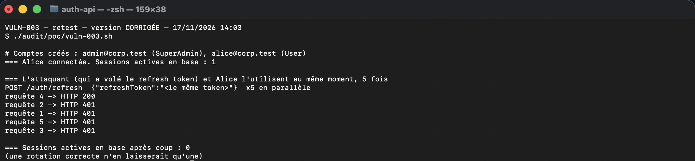

# VULN-003 : un refresh token qui sert plusieurs fois

Identifiant : VULN-003

Nom : Le refresh token devrait servir une seule fois, mais plusieurs requêtes en même temps passent

Localisation : `POST /auth/refresh`, fonction `refreshToken` dans `src/controllers/auth.controller.ts`

Criticité : Élevée. Avec un refresh token volé, l'attaquant obtient sa propre session de 7 jours, qu'il peut renouveler sans fin, et la victime ne voit rien. Il faut d'abord voler le token.

Statut : Corrigée et retestée

## Description

À chaque refresh, l'ancien token doit être annulé pour qu'il ne serve qu'une fois. Le code
lisait le token, vérifiait qu'il n'était pas révoqué, et ne le révoquait qu'un peu plus tard.
Entre les deux, d'autres requêtes avec le même token passaient la vérification.

Autre souci : quand un token déjà utilisé revenait, ce qui est un signe de vol, l'API répondait
juste `401`. Elle ne coupait pas la session que l'attaquant avait déjà obtenue.

## Scénario d'exploitation

L'attaquant vole le refresh token d'Alice. Il l'envoie au moment où Alice rafraîchit sa session.
Les deux obtiennent une session valide, et chacun renouvelle ensuite la sienne. Alice ne se rend
compte de rien.

## Preuve (PoC)

Sur le code vulnérable (commit `ae87776`). J'envoie la même requête 5 fois en parallèle :

```http
POST /auth/refresh
Content-Type: application/json

{"refreshToken":"<le même refresh token>"}
```

```bash
./audit/outils/demo.sh 003 poc
```

```text
=== Alice connectée. Sessions actives en base : 1
requête 4 -> HTTP 200
requête 3 -> HTTP 401
requête 1 -> HTTP 200
requête 5 -> HTTP 401
requête 2 -> HTTP 200

=== Sessions actives en base après coup : 3
```

Un seul token a ouvert 3 sessions.



## Impact

L'attaquant garde un accès au compte, sans être vu, pendant 7 jours renouvelables. Si la victime
est admin, il garde aussi ses droits d'administration.

## Correction

J'ai fait deux changements :

1. Le token n'est annulé que s'il est encore actif, en une seule opération en base
   (`updateMany ... where revokedAt: null`). Sur plusieurs requêtes en même temps, une seule
   peut gagner.
2. Si un token déjà utilisé revient, ou si une requête perd la course, l'API coupe toutes les
   sessions de l'utilisateur et l'écrit dans le journal (`REFRESH_TOKEN_REUSE`). L'attaquant
   perd l'accès, et Alice n'a qu'à se reconnecter.

Avant :
```ts
if (!dbToken || dbToken.revokedAt || ...) return res.status(401)...;
// ... plus tard, sans condition :
prisma.refreshToken.update({ where: { id: dbToken.id }, data: { revokedAt: new Date() } }),
```

Après :
```ts
if (dbToken.revokedAt) {                       // token rejoué : vol probable
  await revokeAllSessions(dbToken.userId);
  await logRefreshTokenReuse(dbToken.userId, req.ip);
  return res.status(401)...;
}
const consumed = await prisma.refreshToken.updateMany({
  where: { id: dbToken.id, revokedAt: null },  // seulement s'il est encore actif
  data: { revokedAt: new Date() }
});
if (consumed.count === 0) {                    // une autre requête l'a déjà utilisé
  await revokeAllSessions(user.id);
  return res.status(401)...;
}
```

## Retest

Même script, sur le code corrigé :

```text
requête 4 -> HTTP 200
requête 2 -> HTTP 401
requête 1 -> HTTP 401
requête 5 -> HTTP 401
requête 3 -> HTTP 401

=== Sessions actives en base après coup : 0
```

Une seule requête passe. Comme le même token a été envoyé plusieurs fois, l'API coupe ensuite
toutes les sessions, y compris celle de l'attaquant.



Tests automatiques : tests `VULN-003` de `tests/api.test.ts` (token rejoué et course perdue).

Résultat : la faille n'est plus exploitable.
