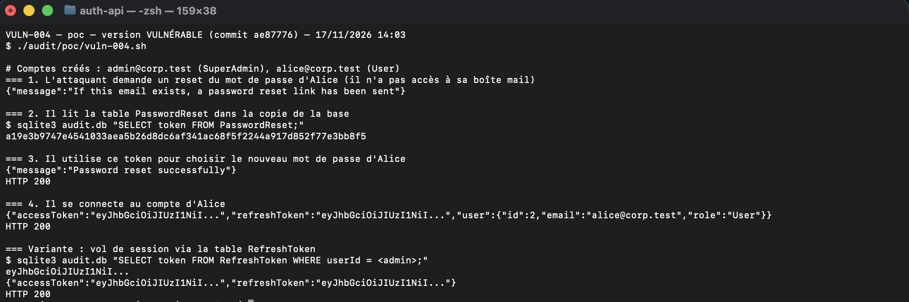
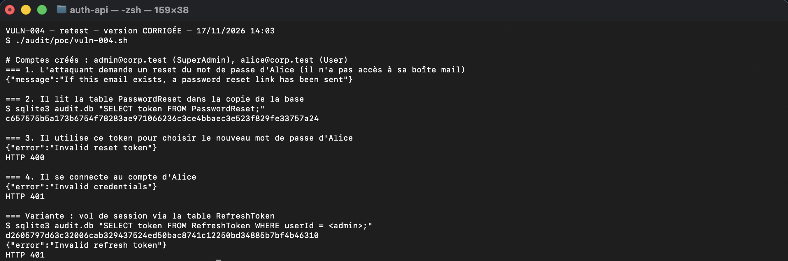

# VULN-004 : les tokens sont écrits en clair dans la base

Identifiant : VULN-004

Nom : Refresh tokens, invitations et liens de reset stockés en clair

Localisation : Tables `RefreshToken`, `Invitation` et `PasswordReset` (`prisma/schema.prisma`), remplies par `src/controllers/auth.controller.ts` et `src/controllers/email.controller.ts`

Criticité : Élevée. Quelqu'un qui peut lire la base peut prendre n'importe quel compte, SuperAdmin compris. Il faut quand même un accès en lecture à la base (sauvegarde, fichier SQLite, fuite).

Statut : Corrigée et retestée

## Description

Un token, c'est comme un mot de passe : celui qui l'a peut agir à la place de l'utilisateur. Les
mots de passe étaient bien hachés avec bcrypt, mais les tokens étaient enregistrés tels quels.
Avec SQLite, toute la base est un seul fichier. Une copie de ce fichier suffit pour récupérer
des tokens qui marchent.

## Scénario d'exploitation

L'attaquant récupère une copie de la base (sauvegarde mal protégée, serveur compromis). Il
demande un reset de mot de passe pour Alice, lit le token dans la table `PasswordReset` et
choisit lui-même le nouveau mot de passe. Il peut aussi prendre directement le refresh token de
l'admin dans `RefreshToken`.

## Preuve (PoC)

Sur le code vulnérable (commit `ae87776`) :

```http
POST /auth/reset-password
Content-Type: application/json

{"token":"<token lu dans la table PasswordReset>","password":"Hacked123!"}
```

```bash
./audit/outils/demo.sh 004 poc
```

```text
=== 2. Il lit la table PasswordReset dans la copie de la base
$ sqlite3 audit.db "SELECT token FROM PasswordReset;"
a19e3b9747e4541033aea5b26d8dc6af341ac68f5f2244a917d852f77e3bb8f5

=== 3. Il utilise ce token pour choisir le nouveau mot de passe d'Alice
{"message":"Password reset successfully"}
HTTP 200

=== 4. Il se connecte au compte d'Alice
HTTP 200

=== Variante : vol de session via la table RefreshToken
$ sqlite3 audit.db "SELECT token FROM RefreshToken WHERE userId = <admin>;"
eyJhbGciOiJIUzI1NiI...
HTTP 200
```

Avec ce qu'il a lu dans la base, l'attaquant prend le compte d'Alice et la session de l'admin.



## Impact

Tous les comptes peuvent être pris, administrateurs compris, juste en lisant la base. Une
sauvegarde qui fuit devient une prise de contrôle complète.

## Correction

La base ne garde plus que l'empreinte SHA-256 du token. Le vrai token ne passe que dans la
réponse HTTP ou dans l'email. Quand un token arrive, l'API calcule son empreinte et la compare à
celle de la base.

SHA-256 suffit ici, pas besoin de bcrypt : les tokens sont longs et aléatoires, donc impossibles
à retrouver en essayant toutes les valeurs.

Avant :
```ts
await prisma.passwordReset.create({ data: { token, userId: user.id, ... } });
const resetRecord = await prisma.passwordReset.findUnique({ where: { token } });
```

Après :
```ts
// src/utils/tokens.ts
export function hashToken(token: string): string {
  return crypto.createHash('sha256').update(token).digest('hex');
}

await prisma.passwordReset.create({ data: { token: hashToken(token), userId: user.id, ... } });
const resetRecord = await prisma.passwordReset.findUnique({ where: { token: hashToken(token) } });
```

J'ai fait le même changement pour les invitations et les refresh tokens (`issueSession`,
`refreshToken`, `logout`). Pas besoin de migration, la colonne reste du texte. À savoir pour le
déploiement : les sessions et les liens créés avant la correction ne marchent plus, il faut se
reconnecter.

## Retest

Même script, sur le code corrigé :

```text
$ sqlite3 audit.db "SELECT token FROM PasswordReset;"
c657575b5a173b6754f78283ae971066236c3ce4bbaec3e523f829fe33757a24
{"error":"Invalid reset token"}
HTTP 400

=== 4. Il se connecte au compte d'Alice
{"error":"Invalid credentials"}
HTTP 401

$ sqlite3 audit.db "SELECT token FROM RefreshToken WHERE userId = <admin>;"
d2605797d63c32006cab329437524ed50bac8741c12250bd34885b7bf4b46310
{"error":"Invalid refresh token"}
HTTP 401
```

Ce qu'on lit dans la base n'est plus qu'une empreinte, et elle ne sert à rien à l'attaquant.



Tests automatiques : `tests/api.test.ts` et `tests/email-flows.test.ts` vérifient que la base
contient l'empreinte du token, jamais le token lui-même.

Résultat : la faille n'est plus exploitable.
