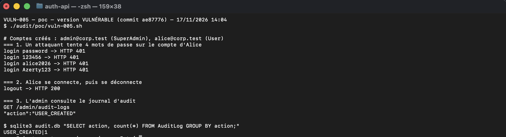
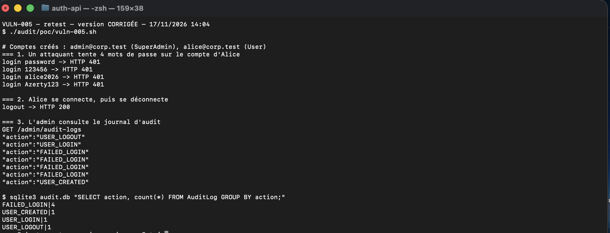

# VULN-005 : les connexions n'apparaissent pas dans le journal d'audit

Identifiant : VULN-005

Nom : Connexions, échecs de connexion et resets non enregistrés

Localisation : `login` et `logout` dans `src/controllers/auth.controller.ts`, `resetPassword` dans `src/controllers/email.controller.ts`. Les fonctions `logFailedLogin`, `logUserLogin`, `logUserLogout` et `logPasswordReset` existaient dans `src/services/audit.service.ts`, mais personne ne les appelait.

Criticité : Moyenne. Ça ne permet pas d'attaquer, mais les attaques deviennent invisibles (force brute, compte volé) et on ne peut pas enquêter après coup.

Statut : Corrigée et retestée

## Description

Le journal d'audit n'enregistrait que les actions d'administration : création de compte,
changement de rôle, changement de statut. Une attaque par force brute, une connexion suspecte
ou un reset de mot de passe ne laissaient aucune trace.

## Scénario d'exploitation

L'attaquant essaie plusieurs mots de passe sur le compte d'Alice, finit par entrer, puis se
déconnecte. L'admin ouvre le journal et n'y trouve rien. Il ne peut pas savoir qu'il y a eu une
attaque, ni quand, ni depuis quelle IP.

## Preuve (PoC)

Sur le code vulnérable (commit `ae87776`) :

```http
POST /auth/login     {"email":"alice@corp.test","password":"password"}    (4 fois, mauvais mots de passe)
POST /auth/login     {"email":"alice@corp.test","password":"AlicePass123!"}
POST /auth/logout    {"refreshToken":"..."}
GET  /admin/audit-logs
```

```bash
./audit/outils/demo.sh 005 poc
```

```text
login password -> HTTP 401
login 123456 -> HTTP 401
login alice2026 -> HTTP 401
login Azerty123 -> HTTP 401
logout -> HTTP 200

$ sqlite3 audit.db "SELECT action, count(*) FROM AuditLog GROUP BY action;"
USER_CREATED|1
```

4 échecs, une connexion et une déconnexion, et le journal ne contient que la création du compte.



## Impact

On ne peut pas repérer les attaques sur les comptes. En cas d'incident, impossible de retrouver
ce qui s'est passé. Ça pose aussi problème pour la traçabilité exigée par le RGPD, par exemple
pour déclarer une fuite.

## Correction

Chaque événement de connexion est maintenant enregistré avec l'IP : échec de connexion (avec
l'email visé), connexion réussie, déconnexion, reset de mot de passe, et réutilisation d'un
refresh token (voir VULN-003).

Avant :
```ts
if (!user || !validPassword) {
  return res.status(401).json({ error: 'Invalid credentials' });
}
```

Après :
```ts
if (!user || !validPassword) {
  await logFailedLogin(email, req.ip);
  return res.status(401).json({ error: 'Invalid credentials' });
}
// ...
await logUserLogin(user.id, req.ip);                 // connexion réussie
await logUserLogout(session.userId, req.ip);         // déconnexion
await logPasswordReset(resetRecord.userId, req.ip);  // reset du mot de passe
```

## Retest

Même script, sur le code corrigé :

```text
$ sqlite3 audit.db "SELECT action, count(*) FROM AuditLog GROUP BY action;"
FAILED_LOGIN|4
USER_CREATED|1
USER_LOGIN|1
USER_LOGOUT|1
```

Les 4 échecs, la connexion et la déconnexion sont bien dans le journal.



Tests automatiques : bloc `(VULN-005)` de `tests/security.test.ts`, et les vérifications de
`USER_LOGOUT` (`tests/api.test.ts`) et `PASSWORD_RESET` (`tests/email-flows.test.ts`).

Résultat : la faille est corrigée, les connexions sont tracées.
