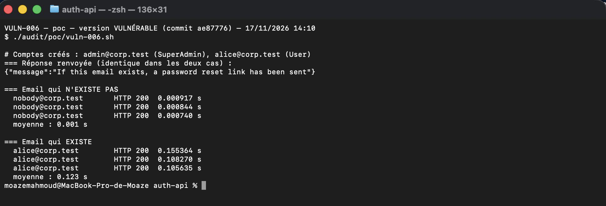
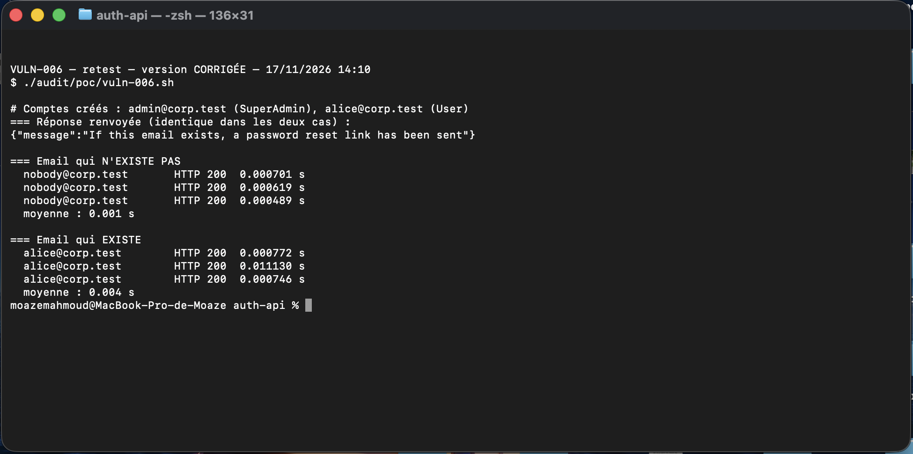

# VULN-006 : savoir si un email a un compte grâce au temps de réponse

Identifiant : VULN-006

Nom : Deviner les comptes existants en mesurant le temps de réponse

Localisation : `POST /auth/forgot-password`, fonction `forgotPassword` dans `src/controllers/email.controller.ts`

Criticité : Moyenne. Ça marche à chaque fois, sans compte. Ça ne donne pas accès aux comptes, mais l'attaquant obtient la liste des cibles, qu'il utilise ensuite pour VULN-007, VULN-008 ou du phishing.

Statut : Corrigée et retestée

## Description

Le message de réponse était le même dans tous les cas, ça c'était bien fait. Mais quand le compte
existait, le serveur créait un lien en base et attendait que l'email parte (appel à Resend) avant
de répondre. Pour un email inscrit, la réponse était donc environ 100 fois plus lente.

## Scénario d'exploitation

L'attaquant a une liste d'emails de l'entreprise. Pour chacun, il appelle `forgot-password` et
regarde combien de temps la réponse met. Au-dessus de 50 ms, le compte existe. Il obtient ainsi
la liste des utilisateurs, qu'il attaque ensuite.

## Preuve (PoC)

Sur le code vulnérable (commit `ae87776`) :

```http
POST /auth/forgot-password
Content-Type: application/json

{"email":"alice@corp.test"}
```

```bash
./audit/outils/demo.sh 006 poc
```

```text
=== Email qui N'EXISTE PAS
  nobody@corp.test       HTTP 200  0.000917 s
  nobody@corp.test       HTTP 200  0.000844 s
  nobody@corp.test       HTTP 200  0.000740 s
  moyenne : 0.001 s

=== Email qui EXISTE
  alice@corp.test        HTTP 200  0.155364 s
  alice@corp.test        HTTP 200  0.108270 s
  alice@corp.test        HTTP 200  0.105635 s
  moyenne : 0.123 s
```

Même réponse, mais 1 ms contre 123 ms. On voit tout de suite qu'Alice a un compte.



## Impact

La liste des utilisateurs fuite, et ce sont des données personnelles. C'est en général la
première étape d'une attaque ciblée sur des comptes.

## Correction

L'API répond maintenant avant de faire quoi que ce soit : pas de recherche en base, pas
d'écriture, pas d'email. Tout ça se fait après la réponse. Le temps de réponse est donc le même,
que le compte existe ou non.

Avant :
```ts
const user = await prisma.user.findUnique({ where: { email } });
if (!user || !user.isActive) return res.json(genericResponse);   // rapide
await prisma.passwordReset.create({ ... });
await sendPasswordResetEmail(email, token);                       // ~100 ms
res.json(genericResponse);                                        // lent
```

Après :
```ts
res.json({ message: 'If this email exists, a password reset link has been sent' }); // tout de suite

try {
  await issuePasswordReset(email);   // recherche, lien et email : après la réponse
} catch (error) {
  console.error('[forgot-password] échec du traitement :', error);
}
```

Ma première correction ne suffisait pas. Je n'avais mis en arrière-plan que l'envoi de l'email,
et le retest montrait encore 1 ms contre 3 ms, à cause des écritures en base. C'est pour ça que
tout se fait maintenant après la réponse.

## Retest

Même script, sur le code corrigé :

```text
=== Email qui N'EXISTE PAS
  nobody@corp.test       HTTP 200  0.000701 s
  nobody@corp.test       HTTP 200  0.000619 s
  nobody@corp.test       HTTP 200  0.000489 s
  moyenne : 0.001 s

=== Email qui EXISTE
  alice@corp.test        HTTP 200  0.000772 s
  alice@corp.test        HTTP 200  0.011130 s
  alice@corp.test        HTTP 200  0.000746 s
  moyenne : 0.004 s
```

La 2e mesure (11 ms) est un ralentissement ponctuel de ma machine : les deux autres sont sous
1 ms, comme pour l'email qui n'existe pas. Avant la correction, chaque mesure dépassait 100 ms.



Test automatique : bloc `(VULN-006)` de `tests/security.test.ts`. La base y est simulée pour ne
jamais répondre, et l'API répond quand même. Ça prouve qu'elle n'attend plus la recherche du
compte.

Résultat : la faille n'est plus exploitable.
