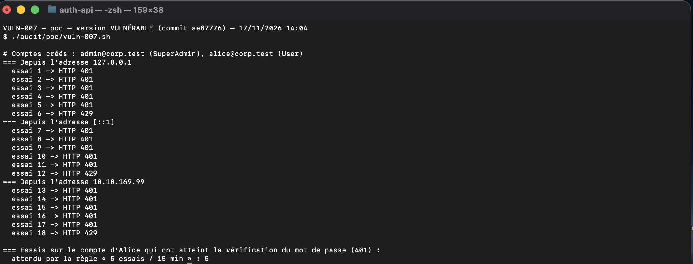
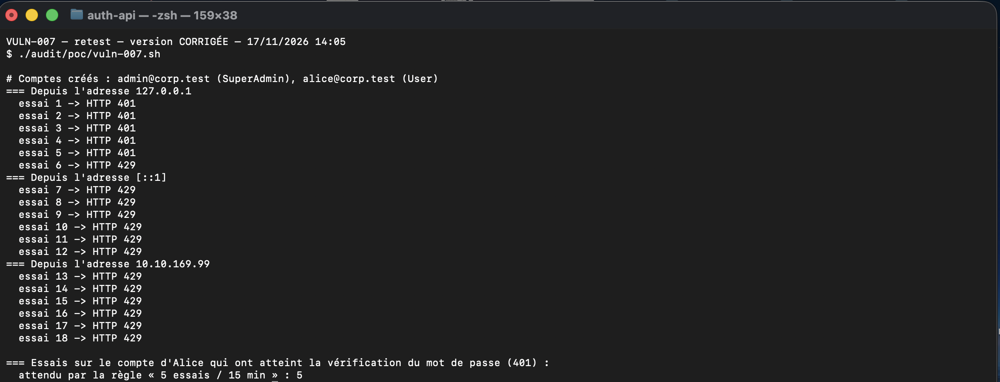

# VULN-007 : contourner l'anti brute-force en changeant d'IP

Identifiant : VULN-007

Nom : Les essais de connexion sont limités par IP seulement

Localisation : `POST /auth/login`, `loginRateLimit` dans `src/middlewares/rateLimit.ts`, route dans `src/routes/index.ts`

Criticité : Élevée. La limite de 5 essais par 15 minutes ne protège plus le compte dès que l'attaquant a plusieurs IP. Avec 100 proxys, ça fait environ 48 000 essais par jour sur le même compte, assez pour trouver un mot de passe faible.

Statut : Corrigée et retestée

## Description

Le compteur d'essais était rangé par adresse IP. Chaque nouvelle IP repartait donc avec 5
essais neufs sur le même compte. Avec des proxys, un VPN ou un botnet, on a des milliers d'IP.

## Scénario d'exploitation

L'attaquant vise `alice@corp.test`, une adresse qu'il a pu trouver grâce à VULN-006. Il répartit
une liste de mots de passe courants sur plusieurs IP, 5 essais chacune, jusqu'à tomber sur le
bon.

## Preuve (PoC)

Sur le code vulnérable (commit `ae87776`). Le serveur de test écoute sur toutes les interfaces,
donc `127.0.0.1`, `::1` et l'IP locale du Mac sont trois clients différents pour lui.

```http
POST /auth/login
Content-Type: application/json

{"email":"alice@corp.test","password":"essai1"}
```

```bash
./audit/outils/demo.sh 007 poc
```

```text
=== Depuis l'adresse 127.0.0.1
  essai 1 à 5 -> HTTP 401
  essai 6 -> HTTP 429
=== Depuis l'adresse [::1]
  essai 7 à 11 -> HTTP 401      <- 5 essais de plus sur le même compte
  essai 12 -> HTTP 429
=== Depuis l'adresse 10.10.169.99
  essai 13 à 17 -> HTTP 401     <- encore 5
  essai 18 -> HTTP 429
```

15 mots de passe testés au lieu de 5.



## Impact

Les comptes avec un mot de passe faible peuvent être pris, y compris les comptes admin.

## Correction

J'ai ajouté une deuxième limite, rangée cette fois par compte visé (l'email), quelle que soit
l'IP : 5 essais par 15 minutes. La limite par IP reste en place, pour un attaquant qui vise
beaucoup de comptes depuis une seule IP. La clé est la même que le compte existe ou non, donc
cette limite ne révèle rien.

Avant :
```ts
router.post('/auth/login', loginRateLimit, validate(LoginSchema), login);
```

Après :
```ts
// rateLimit.ts
const byTargetEmail = (scope: string) => (req: Request) =>
  `${scope}:${String(req.body?.email ?? '').trim().toLowerCase()}`;
export const loginAccountRateLimit = rateLimit(5, 15 * 60 * 1000, byTargetEmail('login'));

// routes/index.ts
router.post('/auth/login', loginRateLimit, validate(LoginSchema), loginAccountRateLimit, login);
```

Il reste une limite. Un attaquant peut bloquer exprès la connexion d'Alice pendant 15 minutes en
ratant 5 fois. C'est le compromis classique : mieux vaut un blocage de 15 minutes qu'un compte
volé. Autre point : les compteurs sont gardés en mémoire. Si l'API tourne un jour sur plusieurs
serveurs, il faudra les mettre dans Redis.

## Retest

Même script, sur le code corrigé :

```text
=== Depuis l'adresse 127.0.0.1
  essai 1 à 5 -> HTTP 401
  essai 6 -> HTTP 429
=== Depuis l'adresse [::1]
  essai 7 à 12 -> HTTP 429      <- le compte est protégé, peu importe l'IP
=== Depuis l'adresse 10.10.169.99
  essai 13 à 18 -> HTTP 429
```



Tests automatiques : bloc `(VULN-007)` de `tests/security.test.ts`. Ils simulent plusieurs IP et
vérifient aussi que les autres comptes ne sont pas bloqués.

Résultat : la faille n'est plus exploitable.
