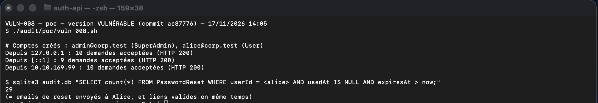
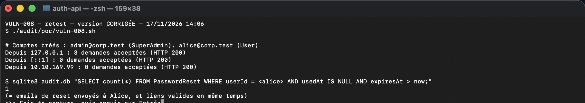

# VULN-008 : inonder la boîte mail de quelqu'un avec des emails de reset

Identifiant : VULN-008

Nom : Demandes de reset illimitées pour un même email, et plusieurs liens valides en même temps

Localisation : `POST /auth/forgot-password` (fonction `forgotPassword` dans `src/controllers/email.controller.ts`) et `sensitiveRateLimit` dans `src/middlewares/rateLimit.ts`

Criticité : Moyenne. On peut harceler un utilisateur, consommer le quota d'envoi et faire classer le domaine en spam. Ça ne donne pas accès aux comptes.

Statut : Corrigée et retestée

## Description

Il y avait deux problèmes :

1. La limite était par IP (10 demandes par 15 minutes). En changeant d'IP, on pouvait envoyer
   autant d'emails qu'on voulait à la même personne.
2. Chaque demande créait un nouveau lien sans annuler les anciens. Un seul compte pouvait donc
   avoir des dizaines de liens de reset valides en même temps.

## Scénario d'exploitation

L'attaquant envoie des centaines de demandes pour `alice@corp.test` depuis plusieurs IP. Alice
reçoit des centaines d'emails. Le service d'envoi (Resend) arrive au bout de son quota, et les
vrais emails, comme les invitations, ne partent plus ou finissent en spam.

## Preuve (PoC)

Sur le code vulnérable (commit `ae87776`). J'envoie 10 demandes depuis chacune des 3 adresses :

```http
POST /auth/forgot-password
Content-Type: application/json

{"email":"alice@corp.test"}
```

```bash
./audit/outils/demo.sh 008 poc
```

```text
Depuis 127.0.0.1 : 10 demandes acceptées (HTTP 200)
Depuis [::1] : 9 demandes acceptées (HTTP 200)
Depuis 10.10.169.99 : 10 demandes acceptées (HTTP 200)

$ sqlite3 audit.db "SELECT count(*) FROM PasswordReset WHERE userId = <alice> AND usedAt IS NULL AND expiresAt > now;"
29
```

29 emails envoyés à Alice, et 29 liens valides en même temps.



## Impact

L'utilisateur est harcelé, l'envoi coûte de l'argent, les emails normaux sont bloqués et le
domaine peut finir sur liste noire. Et avec 29 liens valides, il suffit qu'un seul email fuite.

## Correction

1. J'ai ajouté une limite par email visé : 3 demandes par heure, quelle que soit l'IP. La clé est
   la même que le compte existe ou non.
2. Une nouvelle demande annule les anciens liens. Il n'y a plus qu'un seul lien valide à la
   fois.

Avant :
```ts
router.post('/auth/forgot-password', sensitiveRateLimit, validate(ForgotPasswordSchema), forgotPassword);
// ...
await prisma.passwordReset.create({ data: { token, userId: user.id, ... } });
```

Après :
```ts
export const passwordResetAccountRateLimit = rateLimit(3, 60 * 60 * 1000, byTargetEmail('reset'));
router.post('/auth/forgot-password', sensitiveRateLimit, validate(ForgotPasswordSchema),
  passwordResetAccountRateLimit, forgotPassword);
// ...
await prisma.passwordReset.updateMany({        // les anciens liens ne marchent plus
  where: { userId: user.id, usedAt: null },
  data: { usedAt: new Date() }
});
await prisma.passwordReset.create({ data: { token: hashToken(token), userId: user.id, ... } });
```

## Retest

Même script, sur le code corrigé :

```text
Depuis 127.0.0.1 : 3 demandes acceptées (HTTP 200)
Depuis [::1] : 0 demandes acceptées (HTTP 200)
Depuis 10.10.169.99 : 0 demandes acceptées (HTTP 200)

$ sqlite3 audit.db "SELECT count(*) FROM PasswordReset WHERE ... valides ...;"
1
```

3 demandes passent au total, puis tout est bloqué, et il ne reste qu'un lien valide.



Tests automatiques : bloc `(VULN-008)` de `tests/security.test.ts` (la 4e demande, depuis une
nouvelle IP, donne `429`) et test `VULN-008` de `tests/email-flows.test.ts` (les anciens liens
sont annulés).

Résultat : la faille n'est plus exploitable.
