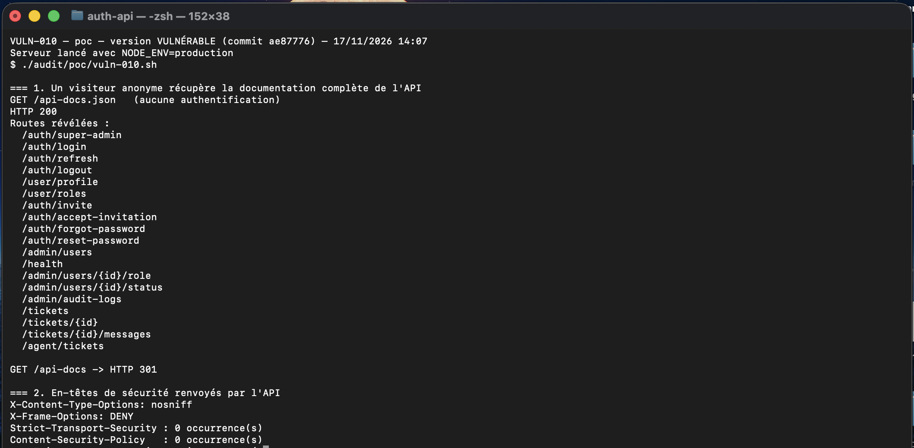
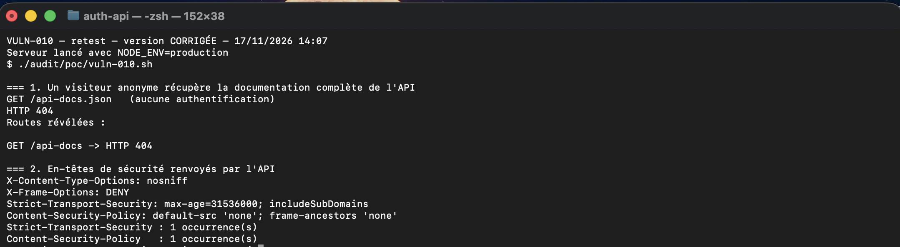

# VULN-010 : la carte de l'API est publique en production

Identifiant : VULN-010

Nom : Documentation Swagger accessible en production, et en-têtes HSTS et CSP absents

Localisation : `src/app.ts` (routes `/api-docs` et `/api-docs.json`, et middleware des en-têtes)

Criticité : Faible. Ça ne donne aucun accès tout seul, mais l'attaquant gagne du temps pour repérer les routes sensibles, et le navigateur perd deux protections.

Statut : Corrigée et retestée

## Description

1. La documentation interactive était servie à tout le monde, même avec `NODE_ENV=production`.
   Elle liste toutes les routes, leurs paramètres, les rôles et les codes de réponse, y compris
   les routes d'administration et `/auth/super-admin`.
2. Deux en-têtes de sécurité manquaient. `Strict-Transport-Security` oblige le navigateur à
   passer en HTTPS. `Content-Security-Policy` interdit l'exécution de scripts dans les réponses
   de l'API.

## Scénario d'exploitation

Un attaquant ouvre `/api-docs.json`. En une requête, il a la carte complète de l'API et sait
tout de suite quelles routes viser. Et sans HSTS, quelqu'un sur un Wi-Fi piégé peut être renvoyé
vers une version HTTP de l'API, où ses tokens peuvent être interceptés.

## Preuve (PoC)

Sur le code vulnérable (commit `ae87776`), serveur lancé avec `NODE_ENV=production` :

```http
GET /api-docs.json
```

```bash
./audit/outils/demo.sh 010 poc
```

```text
GET /api-docs.json   (aucune authentification)
HTTP 200
Routes révélées :
  /auth/super-admin
  /admin/users/{id}/role
  /admin/users/{id}/status
  /admin/audit-logs
  ... (19 routes)

Strict-Transport-Security : 0 occurrence(s)
Content-Security-Policy   : 0 occurrence(s)
```

Sans être connecté, on obtient les 19 routes de l'API, et les deux en-têtes sont absents.



## Impact

Le repérage est plus facile et plus rapide pour l'attaquant. Les tokens sont plus exposés sur
les réseaux pas sûrs.

## Correction

- `/api-docs` et `/api-docs.json` ne sont plus servis en production. On peut les rouvrir
  volontairement avec `ENABLE_API_DOCS=true`.
- `Strict-Transport-Security` est envoyé sur toutes les réponses, et `Content-Security-Policy`
  sur toutes les réponses de l'API. Swagger UI est exclu de la CSP, parce qu'il a besoin de
  scripts pour fonctionner.

Avant :
```ts
app.use('/api-docs', swaggerUi.serve);
app.get('/api-docs', swaggerUi.setup(swaggerSpec));
app.get('/api-docs.json', (_req, res) => res.json(swaggerSpec));
```

Après :
```ts
const apiDocsEnabled = process.env.NODE_ENV !== 'production' || process.env.ENABLE_API_DOCS === 'true';

res.setHeader('Strict-Transport-Security', 'max-age=31536000; includeSubDomains');
if (!req.path.startsWith('/api-docs')) {
  res.setHeader('Content-Security-Policy', "default-src 'none'; frame-ancestors 'none'");
}

if (apiDocsEnabled) {
  app.use('/api-docs', swaggerUi.serve);
  // ...
}
```

## Retest

Même script, serveur corrigé lancé avec `NODE_ENV=production` :

```text
GET /api-docs.json   (aucune authentification)
HTTP 404
GET /api-docs -> HTTP 404

Strict-Transport-Security: max-age=31536000; includeSubDomains
Content-Security-Policy: default-src 'none'; frame-ancestors 'none'
```



Tests automatiques : bloc `(VULN-010)` de `tests/security.test.ts`. Ils vérifient que la doc
renvoie `404` en production, qu'on peut la rouvrir volontairement, et que les en-têtes sont
présents.

Résultat : la faille n'est plus exploitable.
