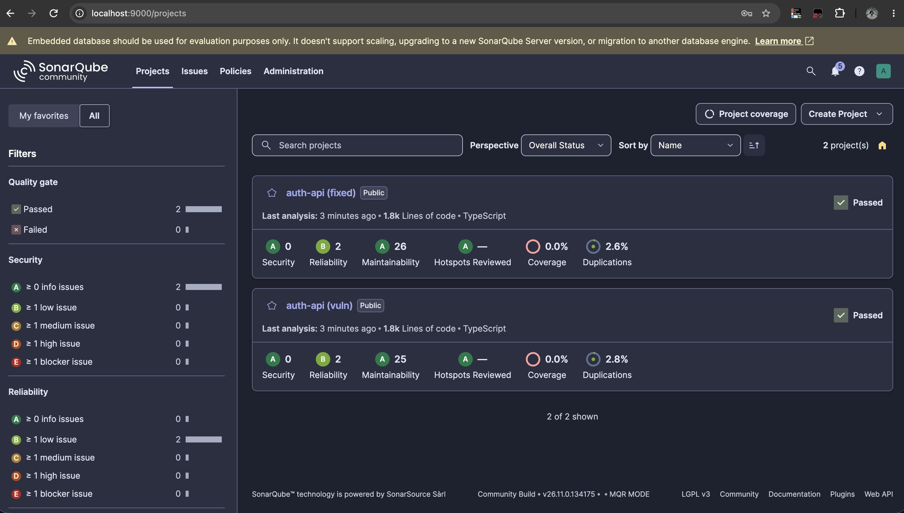

# Analyse statique avec Semgrep et SonarQube

Mes 10 failles, je les ai trouvées en attaquant l'API pour de vrai (test dynamique). Ici, j'ai
voulu voir ce que deux outils d'analyse statique auraient trouvé tout seuls. Ces outils lisent
le code sans le lancer. Je les ai passés sur les deux versions : le code vulnérable (commit
`ae87776`) et le code corrigé (commit `1ec4414`).

La question est simple : est-ce que ces outils auraient suffi ?

## Comment je les ai lancés

Tout tourne sur ma machine, et le code n'est envoyé à aucun service extérieur.

Semgrep 1.185.0, avec 217 règles (registres `p/default`, `p/typescript`, `p/nodejs`,
`p/expressjs`, `p/jwt`, `p/secrets` et `p/owasp-top-ten`) :

```bash
semgrep scan --config p/default --config p/typescript --config p/nodejs --config p/expressjs \
  --config p/jwt --config p/secrets --config p/owasp-top-ten --metrics=off src tests prisma
```

SonarQube Community 26.11, lancé dans Docker, avec le scanner officiel :

```bash
docker run -d --name sonarqube-audit -p 9000:9000 sonarqube:community
docker run --rm --network host -v "$PWD:/usr/src" sonarsource/sonar-scanner-cli \
  -Dsonar.host.url=http://localhost:9000 -Dsonar.token=<token local> \
  -Dsonar.projectKey=auth-api-fixed -Dsonar.sources=src -Dsonar.tests=tests
```

Avec son profil par défaut (« Sonar way core », 199 règles), SonarQube ne trouvait rien du tout.
J'ai donc relancé avec son profil le plus complet, « Sonar way comprehensive » (440 règles).

Résultats bruts : [semgrep-avant.txt](semgrep-avant.txt), [semgrep-apres.txt](semgrep-apres.txt),
[sonarqube-avant.txt](sonarqube-avant.txt) et [sonarqube-apres.txt](sonarqube-apres.txt).

## Ce que Semgrep a trouvé

Il a trouvé 2 alertes sur le code vulnérable et 3 sur le code corrigé. J'ai vérifié chacune, et
ce sont toutes des fausses alertes.

- `unsafe-formatstring` dans `src/services/email.service.ts` (lignes 15 et 21). Semgrep craint
  qu'un attaquant glisse un `%s` dans un message de log. Mais la variable `label` vaut toujours
  un texte écrit en dur dans le code (`'Invitation'` ou `'Password reset'`), jamais une saisie
  de l'utilisateur.
- `hardcoded-jwt-secret` dans `tests/security.test.ts` (ligne 65), seulement sur le code
  corrigé. C'est le faux secret que j'utilise exprès dans le test T4 pour fabriquer un JWT
  pirate et vérifier que l'API le refuse. Ce n'est pas le vrai secret, qui est dans le `.env`.

## Ce que SonarQube a trouvé

Il a trouvé 25 problèmes sur le code vulnérable et 26 sur le code corrigé. Aucun ne concerne la
sécurité, et il n'y a aucun « security hotspot ». Ce sont des remarques de qualité de code :
imports inutilisés, `node:crypto` à préférer à `crypto`, chaînage optionnel, etc. Les 2 points
de « Reliability » sont deux fonctions marquées `async` sans `await` (`hashPassword` et
`comparePassword`). Elles renvoient bien la promesse de bcrypt, donc ça ne change rien au
fonctionnement. La couverture à 0 % veut seulement dire que je n'ai pas envoyé le rapport de
couverture des tests à SonarQube.



Les deux versions ont la note A en sécurité, avec 0 problème. Pour SonarQube, le code vulnérable
est aussi sûr que le code corrigé.

Une remarque m'a quand même fait réfléchir. SonarQube signale 8 blocs `catch` qui récupèrent
l'erreur sans rien en faire (règle S2486), par exemple dans `login` :

```ts
} catch (error) {
  res.status(500).json({ error: 'Login failed' });
}
```

La réponse est bonne : un message neutre, sans détail technique qui fuite. Mais l'erreur n'est
écrite nulle part. Si quelqu'un provoque des erreurs serveur, personne ne le saura. C'est la même
famille de problème que VULN-005 (manque de traces). Je ne l'ai pas classée comme faille, parce
que je n'ai pas réussi à en tirer une attaque, mais c'est un vrai point à améliorer.

## Comparaison avec mes 10 failles

Aucun des deux outils n'a détecté une seule des 10 failles que j'ai prouvées : 0 sur 10 pour
Semgrep, 0 sur 10 pour SonarQube. Et les rapports sont presque identiques avant et après mes
corrections. Pour ces outils, le code vulnérable et le code corrigé se valent.

Ça s'explique par la nature des failles. Elles ne sont pas dans une ligne de code dangereuse,
elles sont dans la logique de l'application :

- VULN-001 et VULN-003 sont des conditions de course. Il faut deux requêtes en même temps pour
  les voir.
- VULN-006 est une question de temps de réponse. Ça ne se voit qu'en mesurant.
- VULN-007 et VULN-008 viennent d'un choix de conception (limiter par IP plutôt que par compte).
  Le code est correct, c'est la règle qui est mauvaise.
- VULN-002 et VULN-005 sont des oublis : une vérification qui manque, des fonctions de log
  jamais appelées. Un outil ne peut pas deviner ce qui aurait dû être là.
- VULN-004 (tokens en clair) : écrire un token dans la base est une opération normale. Rien ne
  dit à l'outil que cette colonne contient un secret.
- VULN-009 (injection de prompt) : les règles classiques ne connaissent pas encore les prompts
  envoyés à une IA.
- VULN-010 (Swagger en production) : c'est une question de configuration.

À l'inverse, les attaques classiques que ces outils savent repérer (injection SQL, secrets dans
le code, JWT mal vérifié) étaient déjà bloquées dans le projet. C'est ce que montrent mes tests
conformes.

## Ce que j'en retiens

Les deux outils sont utiles pour l'hygiène du code, et rapides à lancer. Ils auraient attrapé un
vrai secret oublié dans le code ou une requête SQL construite à la main. Mais sur ce projet, ils
n'auraient trouvé aucune des failles qui comptaient vraiment. Pour celles-là, il a fallu
réfléchir à la façon dont un attaquant utilise l'API, puis l'essayer.

Un rapport SonarQube « vert » ne veut donc pas dire que l'application est sûre. Le mieux est
d'utiliser les deux approches ensemble.
